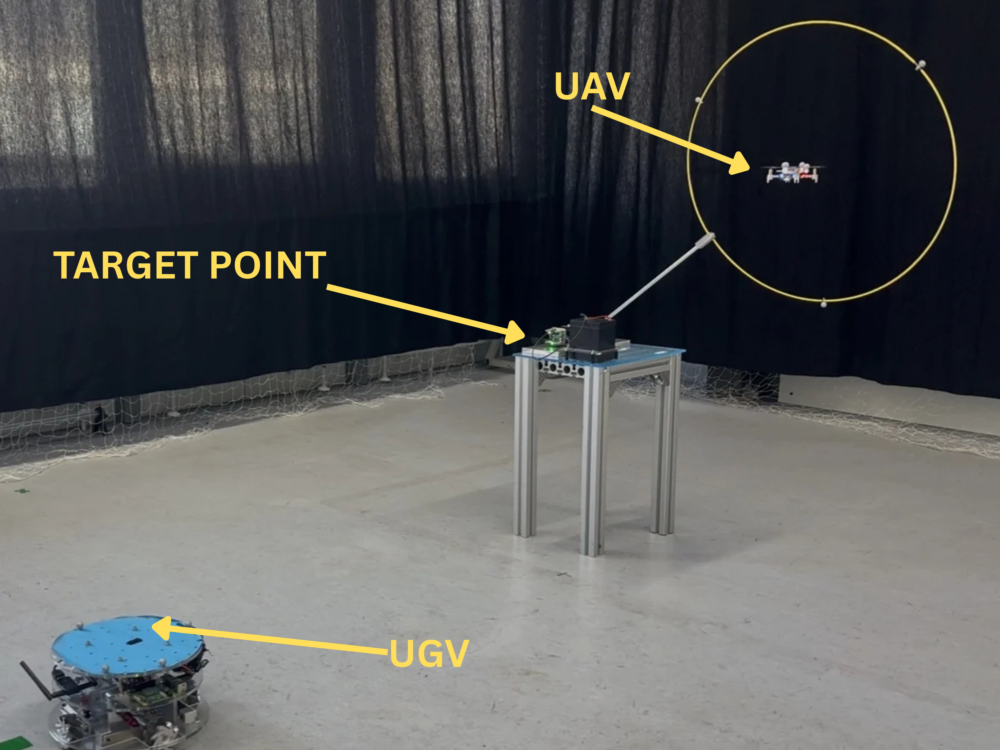
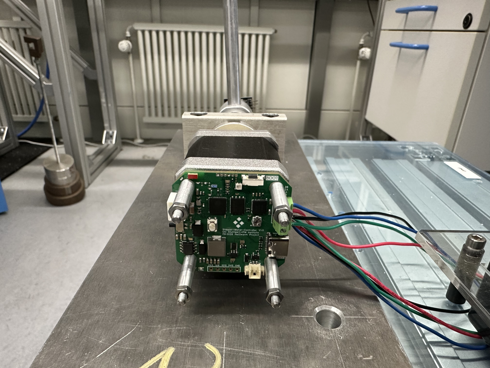
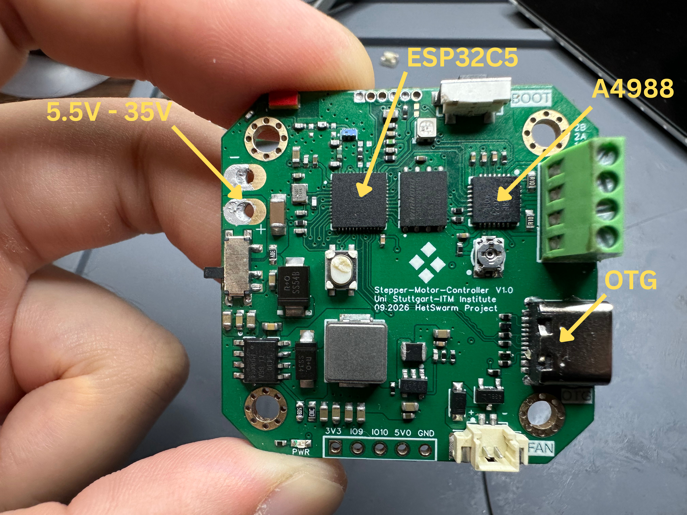
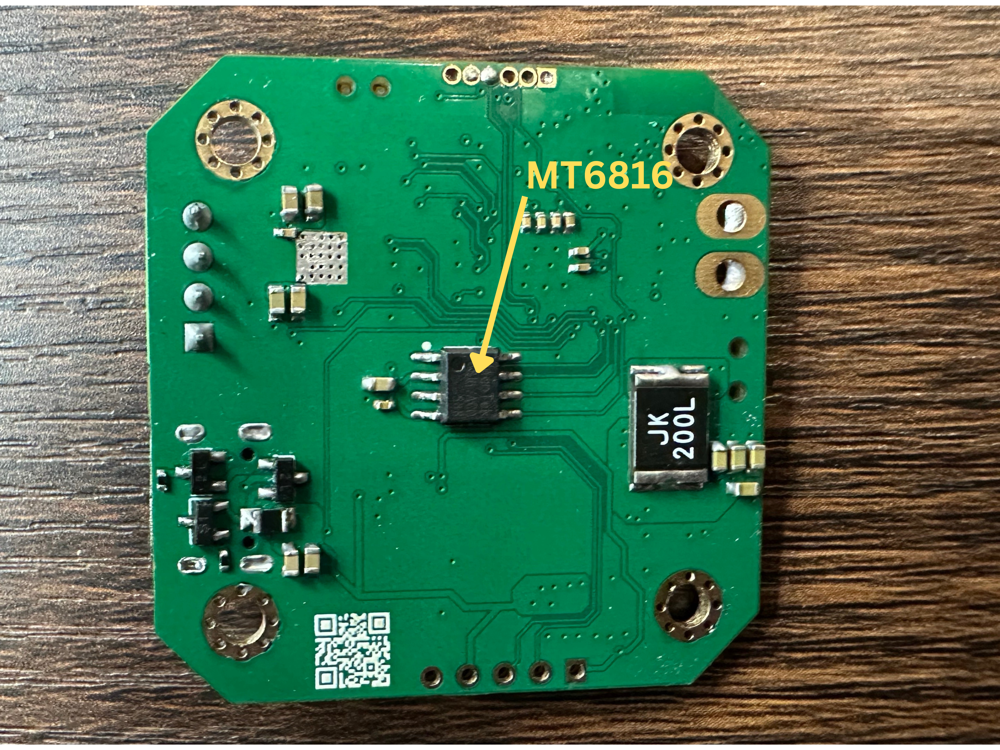
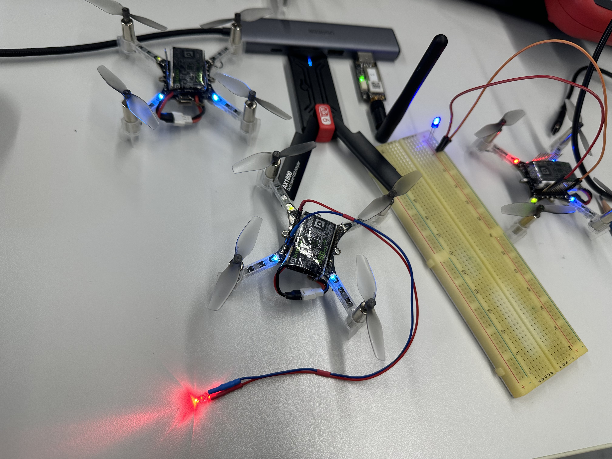

# itm-hiwi

Ziel des Projekts ist es, mithilfe eines Motion-Capture-Systems, ROS 2 und modellprädiktiver Regelung (MPC) eine Crazyflie-Drohne durch einen schwingenden Zielring (Target Point) zu steuern und anschließend auf dem Bodenroboter Hera zu landen.

## Hardware Entwicklung
Meine erste Aufgabe ist die Entwicklung der Hardware für eine geschlossene Schrittmotorregelung. Der ESP32-C5 dient als Mikrocontroller und ermöglicht die Ansteuerung über ROS 2 im 5‑GHz-WLAN des Labors. Ein A4988 treibt den Schrittmotor an, während ein MT6816 den Drehwinkel erfasst und als Rückmeldung für den Regelkreis liefert.

## ESP32-Firmware Entwicklung
Meine zweite Aufgabe ist die Entwicklung der Firmware für den ESP32-C5 auf der Arduino-Plattform. Der ESP32-C5 empfängt die Steuerbefehle von einem ROS-2-Knoten auf dem PC per TCP über das 5‑GHz-WLAN des Labors. Die Firmware setzt die Winkelbefehle in STEP- und DIR-Signale für den A4988 um. Nach jeder Bewegung prüft sie den tatsächlichen Drehwinkel mit dem MT6816, korrigiert bei Bedarf kleine Positionsabweichungen und meldet den gemessenen Winkel sowie den Bewegungsstatus an den PC zurück.

## STM32-Firmware Entwicklung
Die Bitcraze-Firmware um einen zusätzlichen Thread erweitern, der auf einen ROS-2-Befehl hin eine LED einschaltet.

## Host PC Entwicklung

## Simulation in Gazebo

## HetSwarm-Code Aktuallisierung